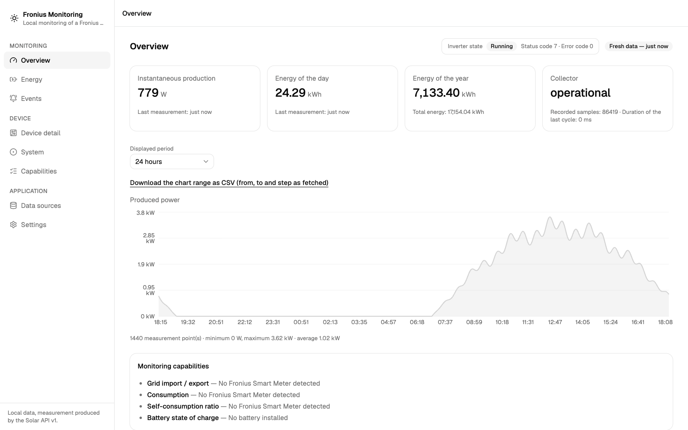
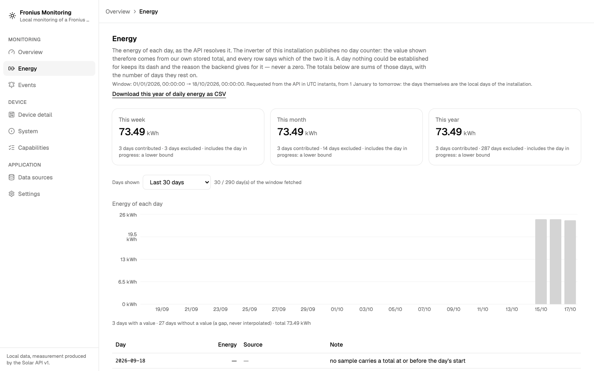

# Fronius Monitoring

**Your inverter produces the data. This keeps it.**

A local, read-only supervisor for the Fronius GEN24 family: production history,
events and daily energy in a SQLite database you own, behind an interface that
keeps working when the inverter is asleep.



No cloud. No account. No telemetry. One Go binary, one file on your disk, one
browser tab.

[Quick start](#quick-start) · [What you get](#what-you-get) · [Screens and guide](docs/USER-GUIDE.md) · [What it will never do](#what-it-will-never-do)

## Why you want it

- **Your history stays yours.** Everything lands in `FRONIUS_DB_PATH`, a plain
  SQLite file you can copy, back up and open with any tool. The interface talks
  only to the service on the same machine.
- **It keeps working when the inverter does not.** History, events, daily energy
  and exports come from the local database — a sleeping inverter, a dead network
  or a power cut do not blank your screen.
- **It cannot change your inverter.** Every client is wrapped in a guard that
  refuses any method but `GET` _before_ a request leaves the process. No
  commands, no configuration writes, no firmware, no self-test triggers. Ever.
- **It tells you what it knows, and what it does not.** A value is labelled
  _measured_ or _derived_; a missing value is a dash **with its reason**; a gap is
  never interpolated; a total that is a lower bound says so.
- **Real history, not a live widget.** Hourly aggregates, daily energy derived
  from the device's stored total, an event journal, and CSV export of all three.

## What you get

| Screen            | What it answers                                                                                                                         |
| ----------------- | --------------------------------------------------------------------------------------------------------------------------------------- |
| **Overview**      | What is the installation doing right now, and how fresh are those numbers?                                                              |
| **Energy**        | What did each local day produce — from the device's counter or derived from the stored total — and what is the week, month, year total? |
| **Events**        | What did the collector and the inverter report, when, and how bad?                                                                      |
| **Device detail** | Identity, system, network, devices, EMRS and cache — each with availability and its reason.                                             |
| **System**        | The device's own clock and its drift (warned beyond ±60 s), its grid-limits self-test state, the detection resources.                   |
| **Capabilities**  | What this installation can and cannot measure, and why.                                                                                 |
| **Data sources**  | The machine-readable catalogue: which path, which fields, which evidence.                                                               |
| **Settings**      | The effective configuration, plus a read-only connectivity test.                                                                        |

Plus: a keyboard-accessible, mobile-ready shell; a connectivity test that tells
you whether the device answers and whether your credentials work; and a CSV
download on every history screen.



_The Energy screen: each day says whether its value is the device's own counter
or was derived from the stored total; the rollups state how many days
contributed, how many were excluded, and that the total is a lower bound while
the day in progress is included._

## Quick start

Requirements: Linux or macOS, Go 1.26+ to build the service, Node.js 22+ with
pnpm to build the interface.

```bash
make build                          # backend into bin/, interface into apps/web/dist

FRONIUS_SOLARAPI_URL=http://<inverter-ip> \
FRONIUS_WEB_DIR=apps/web/dist \
./bin/froniusd
```

Open <http://127.0.0.1:8080>.

The Solar API needs **no credential**: production, energy and the device's own
detail families work out of the box. Add the inverter's credentials only for the
internal read paths (device events, the clock, the self-test state) — the same
command, plus two variables. The cleanest form points at **files** (the
Docker-secrets route, and the one that keeps the password out of the process
environment):

```bash
FRONIUS_SOLARAPI_URL=http://<inverter-ip> \
FRONIUS_WEB_DIR=apps/web/dist \
FRONIUS_DEVICE_USER_FILE=/path/to/device_user \
FRONIUS_DEVICE_PASSWORD_FILE=/path/to/device_password \
./bin/froniusd
```

Setting the two credential variables directly in your shell works as well; the
runbook has the details either way.

No inverter at hand? Reproduce the whole thing against the included simulator:

```bash
make dev-sim                        # deterministic simulator on 127.0.0.1:8081
make seed                           # seven days of synthetic history
FRONIUS_WEB_DIR=apps/web/dist ./bin/froniusd
```

### Run it in Docker

```bash
cp .env.example .env                # set FRONIUS_SOLARAPI_URL (and the credentials if you have them)
docker compose --profile app up -d --build
# http://127.0.0.1:8080
```

The interface is embedded in the binary; the database lives in the `fronius-data`
volume. The port is published on **127.0.0.1 only** — the API has no
authentication of its own, so put a TLS reverse proxy in front before exposing it
further. Running it on a NAS? See [`docs/NAS.md`](docs/NAS.md).

No inverter? The same image runs a complete demo — simulator, a day of synthetic
history, its own volume and port:

```bash
docker compose --profile demo up --build
# http://127.0.0.1:8082
```

Maintenance works from inside the container too:

```bash
docker compose exec froniusd /app/fronius-backup save -out /data/backup.db
docker compose logs -f froniusd
```

### Configuration

| Variable                                          | Default                 | What it does                                                                                  |
| ------------------------------------------------- | ----------------------- | --------------------------------------------------------------------------------------------- |
| `FRONIUS_SOLARAPI_URL`                            | `http://127.0.0.1:8081` | The inverter's base URL.                                                                      |
| `FRONIUS_WEB_DIR`                                 | _(empty — API only)_    | Where the built interface lives; `apps/web/dist` after `make build`.                          |
| `FRONIUS_HTTP_ADDR`                               | `127.0.0.1:8080`        | Where the interface listens. Loopback only unless you knowingly set `FRONIUS_ALLOW_REMOTE=1`. |
| `FRONIUS_DB_PATH`                                 | `./data/fronius.db`     | Your database. Back it up freely.                                                             |
| `FRONIUS_TZ`                                      | `Europe/Brussels`       | The **installation's** time zone — it decides where a day starts and ends.                    |
| `FRONIUS_POLL_INTERVAL`                           | `5s`                    | Collection interval.                                                                          |
| `FRONIUS_RETENTION_DAYS`                          | `0`                     | Purge samples older than N days. `0` keeps everything.                                        |
| `FRONIUS_DEVICE_USER` / `FRONIUS_DEVICE_PASSWORD` | _(empty)_               | Only for the device's internal read paths. They never reach the browser.                      |

The full list is in the [runbook](docs/RUNBOOK.md).

## Different by design

|                              | The inverter's own web console | This application                                              |
| ---------------------------- | ------------------------------ | ------------------------------------------------------------- |
| Where it runs                | on the inverter                | on your machine                                               |
| When the inverter is offline | nothing to see                 | history, events and exports keep working                      |
| What it can change           | configuration and commands     | **nothing** — `GET` only, by construction                     |
| History                      | what the device reports now    | hourly aggregates, daily energy, an event journal, CSV export |
| Numbers                      | as reported                    | _measured_ / _derived_ / _unavailable_, with reasons          |

Use both: the console for configuration, this for the record.

## What it will never do

- Send anything but `GET` to the inverter. The refusal is structural, not a
  setting, not a flag, not the caller's goodwill.
- Change configuration, firmware, grid parameters or passwords, or trigger a
  self-test.
- Phone home, or ask you for an account.
- Show a fabricated number: where a measurement is missing you get a dash and
  the reason — never a zero.

## Compatibility and status

- Built for the **Fronius GEN24** family; developed against a Primo GEN24 3.6 Plus
  on firmware `1.19.7-1`. The Solar API-first design should suit Tauro and Verto,
  but only the GEN24 has been used.
- The core needs no credential. The provenance of every field is documented in
  [Sources](docs/SOURCES.md), including what was observed on hardware and what
  was only read from the manufacturer's client.
- Two internal read paths (`/commands/GetUTCTime`, `/commands/GetServiceState`)
  are marked **unverified on hardware**. When they fail they degrade to
  "unknown, with a reason" — never to an invented value.
- Everything runs against a deterministic simulator in the test suite: no
  hardware is needed to build, test or explore it.

## Documentation

- [**User guide**](docs/USER-GUIDE.md) — every screen, with a screenshot, and how
  to read the numbers.
- [Runbook](docs/RUNBOOK.md) — checks, diagnosis, backup and restore, retention.
- [Architecture](docs/ARCHITECTURE.md) — how it is built and the invariants it keeps.
- [API contract](api/openapi.json) — OpenAPI 3.1, kept in step with the Go DTOs by a test.
- [Sources](docs/SOURCES.md) · [Unknowns](docs/UNKNOWNS.md) · [Endpoints](docs/ENDPOINTS.md)
  — provenance, open questions, and the endpoint matrix.
- [Development](docs/DEVELOPMENT.md) — building, testing, capturing the screenshots.
- [Integrations](docs/INTEGRATIONS.md) — feeding the data to a third-party
  dashboard (gethomepage/homepage widgets in `contrib/homepage/`).

## License

MIT — see [LICENSE](LICENSE).

Not affiliated with, endorsed by, or supported by Fronius International GmbH.
"Fronius" is a trademark of its owner and is used here only to say what this
software reads.
