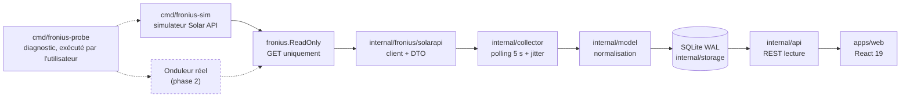

# Architecture

Supervision locale d'un Fronius Primo GEN24 3.6 Plus, en remplacement de
l'interface Angular du fabricant : un backend Go qui collecte et historise, une
API REST locale, une interface React. **Aucune écriture vers l'onduleur.**

## Flux de données

Le simulateur et l'onduleur sont interchangeables : le client ne connaît que
`FRONIUS_SOLARAPI_URL`. La sonde est hors du flux d'exploitation — c'est un
outil de diagnostic manuel, jamais lancé par le service ni par la CI.

## Paquets Go

| Paquet | Rôle | Dépend de |
|---|---|---|
| `cmd/fronius-sim` | Simulateur déterministe de la Solar API (courbe, pannes, `/sim/health`) | — |
| `cmd/froniusd` | Service : config, collecteur, API, arrêt propre | tout |
| `cmd/fronius-probe` | Sonde lecture seule, liste blanche et expurgation | `config`, `fronius` |
| `internal/config` | Configuration par variables d'environnement, garde d'écoute | — |
| `internal/fronius` | Garde lecture seule (`ReadOnly`) | `froniuserr` |
| `internal/fronius/froniuserr` | Erreurs typées (`Kind`, `KindOf`) | — |
| `internal/fronius/solarapi` | Client Solar API et **seul** encodage de la forme du JSON | `fronius`, `froniuserr` |
| `internal/model` | Modèle normalisé, unités, capacités, événements | `solarapi` |
| `internal/storage` | SQLite : migrations, séries, énergie journalière, purge | `model` |
| `internal/collector` | Boucle de collecte, backoff, événements | `solarapi`, `model`, `storage` |
| `internal/api` | API REST, validation, enveloppe et DTO | `model`, `storage`, `config` |

Le sens des dépendances est acyclique et va du plus concret (les binaires) vers
le plus abstrait (les erreurs typées). Aucun paquet interne n'importe un
`cmd/`.

## Frontend

| Chemin | Rôle |
|---|---|
| `src/lib/schema.ts` | Schémas zod **miroirs** de `internal/api/dto.go` |
| `src/lib/api.ts` | `fetchJSON` : échecs classés `network` / `http` / `schema` |
| `src/lib/queries.ts` | Hooks TanStack Query, polling 5 s, plages et pas |
| `src/lib/chart.ts` | Buckets → points de graphique, **trous matérialisés** |
| `src/lib/freshness.ts` | Décision de péremption affichée |
| `src/routes/*` | Vue d'ensemble, Système, Capacités, Paramètres |
| `src/i18n/*` | Dictionnaire plat FR, prêt pour EN/DE |

Le frontend ne parle qu'à `/api` (relayé par le proxy Vite en développement). Il
ne connaît ni l'adresse de l'onduleur, ni un identifiant : la phase 1 n'en
détient aucun.

## Invariants

1. **Lecture seule, garantie par construction.** Tous les clients sont
   construits derrière `fronius.ReadOnly`, qui refuse toute méthode autre que
   `GET` avant d'atteindre le transport. Vérification :
   `grep -rn 'MethodPost\|MethodPut\|MethodDelete\|MethodPatch' internal cmd`
   ne doit rien trouver hors du message d'erreur de la garde et de ses tests.
2. **Aucun zéro inventé.** Une grandeur non mesurée est `null` de bout en bout :
   colonne SQLite NULL, `nil` en Go, `null` en JSON, tiret à l'écran. Ne jamais
   calculer consommation, import/export ou autoconsommation sans Smart Meter :
   les capacités correspondantes sont indisponibles avec leur motif
   (`internal/model/capabilities.go`).
3. **Un échec de collecte n'écrit aucune mesure.** Seuls un cycle, un état
   d'erreur et un événement anti-dupliqué sont enregistrés, et aucune donnée
   n'est interpolée pour combler le trou.
4. **Le temps est explicite.** Les instants sont stockés en UTC à la
   milliseconde ; les journées de production sont locales (Europe/Brussels),
   ce qui gère les journées de 23 h et 25 h. Un horodatage d'appareil absent
   donne un échantillon `estimated`, jamais une heure présentée comme mesurée.
5. **Une seule source de vérité par contrat.** La forme du JSON Fronius
   n'existe que dans `internal/fronius/solarapi/dto.go` ; les DTO REST que dans
   `internal/api/dto.go`, reflétés par `apps/web/src/lib/schema.ts`. Toute
   dérive entre les deux est détectée par zod à l'exécution et par les tests.
6. **Pas de secret dans le dépôt ni dans le frontend.** La phase 1 n'utilise que
   la Solar API, sans authentification. Toute donnée d'authentification future
   restera dans l'environnement du backend.

## Décisions structurantes

Elles sont détaillées dans `docs/adr/` : SQLite plutôt que PostgreSQL (0001),
polling plutôt que SSE (0002), Solar API plutôt qu'API interne (0003), séparation
supervision / commandes (0004), authentification et accès distant (0005),
rétention et agrégation (0006), packaging (0007).

## Points de fragilité connus

- **La forme de la Solar API est une hypothèse.** Le bundle du fabricant ne
  contient aucun chemin Solar API (voir `docs/SOURCES.md`) : `dto.go` encode une
  forme non validée sur le firmware 1.19.7-1. La réconciliation passe par
  `cmd/fronius-probe` et la procédure de `docs/PROBE-READONLY.md`.
- **L'API REST n'a aucune authentification** : elle est confinée à la boucle
  locale par `config.CheckListenAddress` tant que `FRONIUS_ALLOW_REMOTE=1` n'est
  pas défini (ADR 0005).
- **Pas d'adaptateur d'API interne** : ni identité de l'onduleur, ni événements
  matériels, ni détection de batterie ou de compteur. Ces capacités sont
  marquées indisponibles, pas simulées.
