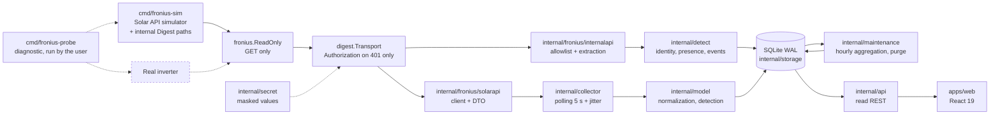

# Architecture

Local supervision of a Fronius Primo GEN24 3.6 Plus, replacing the
manufacturer's Angular interface: a Go backend that collects and historizes, a
local REST API, a React interface. **No writing to the inverter.**

## Data flow

The order `ReadOnly{Inner: digest.Transport{Inner: httpClient}}` is structuring:
the guard is **on the outside**, so the refusal of non-GET methods precedes any
send, and authentication cannot turn a forbidden request into an acceptable one.

The simulator and the inverter are interchangeable: the client knows only
`FRONIUS_SOLARAPI_URL`. The probe is outside the operational flow — it is a manual
diagnostic tool, never started by the service or by CI.

## Go packages

| Package | Role | Depends on |
|---|---|---|
| `cmd/fronius-sim` | Deterministic simulator of the Solar API (curve, failures, `/sim/health`) | — |
| `cmd/froniusd` | Service: config, collector, API, clean shutdown | everything |
| `cmd/fronius-probe` | Read-only probe, allowlist, endpoint selection and redaction | `config`, `fronius`, `digest`, `internalapi`, `secret` |
| `internal/config` | Configuration via environment variables, listen guard | `secret` |
| `internal/secret` | `secret.String`: masked for `fmt`, `slog` and JSON; `Reveal()` is the only way out | — |
| `internal/fronius` | Read-only guard (`ReadOnly`) and shared HTTP/transport classification | `froniuserr` |
| `internal/fronius/froniuserr` | Typed errors (`Kind`, `KindOf`) | — |
| `internal/fronius/digest` | Digest transport (RFC 2617): challenge, header, one retry on 401, nonce cache | `fronius`, `froniuserr`, `secret` |
| `internal/fronius/solarapi` | Solar API client and the **only** encoding of the JSON shape | `fronius`, `froniuserr` |
| `internal/fronius/internalapi` | Internal paths: **executable allowlist** and tolerant extraction | `fronius`, `froniuserr` |
| `internal/model` | Normalized model, units, three-state detection, capabilities, events | `solarapi` |
| `internal/storage` | SQLite: migrations, measurements, hourly aggregates, daily energy, identity, deduplication, purge | `model` |
| `internal/maintenance` | Background work: aggregation of closed hours and scheduled retention purge | `storage`, `model` |
| `internal/collector` | Collection loop, backoff, events | `solarapi`, `model`, `storage` |
| `internal/detect` | Detection loop: identity, presence, events, states and reasons | `internalapi`, `model`, `storage` |
| `internal/api` | REST API, validation, envelope and DTO | `model`, `storage`, `config`, `detect`, `internalapi` |

The direction of the dependencies is acyclic and goes from the most concrete
(the binaries) to the most abstract (the typed errors). No internal package
imports a `cmd/`.

## Frontend

| Path | Role |
|---|---|
| `src/lib/schema.ts` | zod schemas **mirroring** `internal/api/dto.go` |
| `src/lib/api.ts` | `fetchJSON`: failures classified as `network` / `http` / `schema` |
| `src/lib/queries.ts` | TanStack Query hooks, polling 5 s, ranges and steps |
| `src/lib/chart.ts` | Buckets → chart points, **materialized gaps** |
| `src/lib/freshness.ts` | Staleness decision displayed |
| `src/routes/*` | Overview, System, Capabilities, Settings |
| `src/i18n/*` | Flat FR dictionary, ready for EN/DE |

The frontend talks only to `/api` (relayed by the Vite proxy in development). It
knows neither the inverter address nor any credential: no credential enters the
Node process, nor a bundle, nor an HTTP response.

## Invariants

1. **Read-only, guaranteed by construction.** All clients are built behind
   `fronius.ReadOnly`, which refuses any method other than
   `GET` before reaching the transport. Verification:
   `grep -rn 'MethodPost\|MethodPut\|MethodDelete\|MethodPatch' internal cmd`
   must find nothing outside the guard's error message and its tests.
2. **No invented zero.** An unmeasured quantity is `null` end to end:
   SQLite NULL column, `nil` in Go, `null` in JSON, a dash on screen. Never
   compute consumption, import/export or self-consumption without a Smart Meter:
   the corresponding capabilities are unavailable with their reason
   (`internal/model/capabilities.go`).
3. **A collection failure writes no measurement.** Only a cycle, an error state
   and a deduplicated event are recorded, and no data
   is interpolated to fill the gap.
4. **Time is explicit.** Instants are stored in UTC to the
   millisecond; production days are local (Europe/Brussels),
   which handles 23 h and 25 h days. A missing device timestamp
   yields an `estimated` sample, never an hour presented as measured.
5. **A single source of truth per contract.** The shape of the Fronius JSON
   exists only in `internal/fronius/solarapi/dto.go`; the REST DTOs only in
   `internal/api/dto.go`, mirrored by `apps/web/src/lib/schema.ts`. Any
   drift between the two is detected by zod at runtime and by the tests.
6. **No secret in the repository, in a log or in the frontend.** Device
   credentials live in the environment of `froniusd` and
   `fronius-probe`, under the `secret.String` type: any formatting
   (`fmt`, `slog`, JSON) produces `<redacted>`, and only the computation of `HA1` calls
   `Reveal()`. CI refuses a versioned non-empty `FRONIUS_DEVICE_PASSWORD`.
7. **The `Authorization` header is emitted only in response to a 401.** Never
   preemptively, never to a host other than the one of `FRONIUS_SOLARAPI_URL`
   (`digest.ErrForeignHost`), never to the frontend. This is the rule of the
   official client (`callGet$`), and it is what allows the same paths to
   work with or without authentication.
8. **"Absent" is not "undetermined".** Each hardware resource carries
   one of three states (`unknown`, `absent`, `present`), persisted as such,
   exposed by `/api/v1/system` and used by `model.Capabilities`. A read
   that fails produces `unknown` with its reason — never `absent`.
9. **The aggregates are exactly derivable from the retained measurements.** `agg_hour`
   contains only a reduction of the raw measurements and follows the same purge
   boundary: no value survives as an aggregate while its measurements have been
   deleted, and no partial hour is served from a complete aggregate
   (ADR 0006). A read serves an hour from the aggregates only if it is
   whole, closed and contained in the requested range; the rest is read from the
   raw measurements.

## Structuring decisions

They are detailed in `docs/adr/`: SQLite rather than PostgreSQL (0001),
polling rather than SSE (0002), Solar API rather than internal API (0003),
separation of supervision and commands (0004), authentication and remote access (0005),
retention and aggregation (0006), packaging (0007).

## Known fragility points

- **The shape of the Solar API is a hypothesis.** The manufacturer's bundle
  contains no Solar API path (see `docs/SOURCES.md`): `dto.go` encodes a
  shape unvalidated on firmware 1.19.7-1. Reconciliation goes through
  `cmd/fronius-probe` and the procedure in `docs/PROBE-READONLY.md`.
- **The REST API has no authentication**: it is confined to the loopback
  interface by `config.CheckListenAddress` as long as `FRONIUS_ALLOW_REMOTE=1` is
  not set (ADR 0005).
- **Identity keys other than `serialNumber` are candidates.** The model
  and the firmware version of `/status/version` are not named in the
  readable part of the bundle: their extraction rests on ordered lists, to
  be confirmed by capture (see `docs/UNKNOWNS.md`).
- **The shape of `/status/activeEvents` is not established.** The reading, the
  deduplication and the retention of the raw JSON (bounded) do not depend on
  field names; only the displayed label and the severity can change.
- **`battery.soc` stays unavailable even with the battery detected**: the presence of a
  component does not prove that a state-of-charge measurement exists on the API side, and
  announcing it available without a source would be the opposite of invariant 2.
