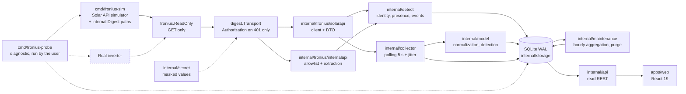

# Architecture

Local supervision of a Fronius Primo GEN24 3.6 Plus, replacing the
manufacturer's Angular interface: a Go backend that collects and historizes, a
local REST API, a React interface. **No writing to the inverter.**

## Data flow

The order `ReadOnly{Inner: digest.Transport{Inner: httpClient}}` is structuring:
the guard is **on the outside**, so the refusal of non-GET methods precedes any
send, and authentication cannot turn a forbidden request into an acceptable one.

The simulator and the inverter are interchangeable: the client knows only
`FRONIUS_SOLARAPI_URL`. The probe is outside the operational flow — it is a manual
diagnostic tool, never started by the service or by CI.

### The device detail snapshot

Readings in two cadences describe the device **itself** rather than its
production, and the API publishes them on a page of their own
(`GET /api/v1/detail`). They are **snapshots**, not series: one row per family in
`device_detail`, replaced on each read, so the table says what the device says
*now* and never accumulates a history — which is why it is carried by
`Store.Restore` but **not** purged with the retention (it is state, like
`device`, not history).

- The **inverter** family is the Solar API collection
  `GetInverterRealtimeData.cgi?Scope=Device&DeviceId=1&DataCollection=CommonInverterData`
  (constant `solarapi.CommonQuery`): its `DeviceStatus` and its thirteen
  measurements. `internal/collector` reads it **every other collection cycle**
  (`detailEveryNCycles = 2`, see the read budget below), beside the measurements
  — the cost of a fresh electrical detail the flow endpoint does not carry.
- The **system**, **network**, **devices** and **emrs** families are read by
  `internal/detect`, on the detection cycle (`FRONIUS_DETECT_INTERVAL`): they
  change rarely, and a snapshot of them belongs with the identity read.
- The **`inverter_info`**, **`active_devices`** and **`api_version`** families
  are the three Solar API requests the detector reads on the same detection
  `GetInverterInfo.cgi`, `GetActiveDeviceInfo.cgi?DeviceClass=System`,
  `GetAPIVersion.cgi`): they need no credential, and they are also **used** —
  the identity and the presence the internal API could not establish come from
  them (see the Solar API-first route below). `/detail` renders them under
  proper headings, not under their raw ids.
- The **cache** family (`/components/cache/readable`) is read by the same
  detector, on the same cycle: `4 897` bytes and `99` values on the reference
  device, so a register dump on every `5 s` collection cycle would be waste. The
  device names its own registers (44 of the 81 carry a `_F32` / `_U64` / `_U16`
  suffix), leaves the other 37 bare (`<id>`), and **no unit is derived from a
  name**: the device states a name and a type, not a unit.

The two cadences are why each family carries its **own** read instant
(`read_at`): the snapshot is not live, and a reader must not present a slow
family as if it had been read with the measurement. A family has three distinct
states: recorded and available; recorded and unavailable **with its reason**;
never read (**absent from the list**).

**The Solar API read budget.** §2.6 of the manufacturer's specification
(`42,0410,2012,EN 02115052025`) allows at most **two realtime requests in
parallel** and requires **4 s between two consecutive calls**. The collector
issues **one read every cycle** — the flow endpoint
(`GetPowerFlowRealtimeData.fcgi`) — and the common inverter collection
(`GetInverterRealtimeData.cgi?…DataCollection=CommonInverterData`) **every other
cycle** (`detailEveryNCycles = 2`): at the default `5 s` interval, alternating
keeps two consecutive requests `5 s` apart instead of `≈0` within one cycle,
which one detail read per cycle would not. `cmd/fronius-probe --survey` paces
itself at the same 4 s between paths, and a lower value is a deliberate,
documented choice (`docs/RUNBOOK.md`, `docs/PROBE-READONLY.md`).

**The Solar API-first route.** Three Solar API requests describe the installation
itself — `GetInverterInfo.cgi` (identity), `GetActiveDeviceInfo.cgi?DeviceClass=System`
(the active-device inventory) and `GetAPIVersion.cgi` (the API version, the one
answer that is not enveloped). They are read by `internal/detect` on the
detection cycle, and, unlike the internal API, **none of them needs a
credential** (`internal/fronius/solarapi/info.go`). They are not merely recorded:
the detector **uses** the first two to **fill** identity and presence when the
authenticated internal read left them undetermined. The precedence is strictly
one-directional — the internal API first, the Solar API **never overwriting** an
answer the device already gave:

- **identity**: it fills `SerialNumber` from `UniqueID` and `DeviceName` from
  `CustomName` **only when the record holds no serial number** (the internal
  `/status/version` refused or was abandoned), sets `Source = GetInverterInfo.cgi`
  and a reason naming the source. It **never invents the model or the firmware**:
  the Solar API does not report them, so they stay empty. An identity the
  authenticated path established is never replaced.
- **presence**: when the internal meter/battery state is `unknown`, the inventory
  settles it — a class reported with at least one device is `present`, a class
  reported empty or not mentioned is `absent`, with `Source =
  GetActiveDeviceInfo.cgi`.

The consequence an operator sees: **identity and presence work with no
credential at all**, while the device events (`/status/activeEvents`) and the two
`/commands/*` read paths (`GetUTCTime`, `GetServiceState`) still need one
(`docs/RUNBOOK.md`). A detector with no `SolarReader` (its `Solar` field nil)
reads the internal paths only and keeps working.

### The events journal and the daily energy

Two read routes of `internal/api` were **served but read by nothing**: the audit
that lists the hooks found `/api/v1/events` had **no hook at all** and
`useEnergyDaily` was used in **zero files**. Each now backs a page of its own.

- **`/api/v1/events`** (`useEvents`, the **Events** page, `/events`) is the
  journal of the collector and of the inverter: collection failures and
  recoveries, retention purges, and the events the device itself reports. The
  table shows time · severity badge · kind label · message, with the raw payload
  of each event in a collapsed disclosure. The endpoint takes only `from`/`to`
  and `limit` (`1..500`, default `100`): it has **no severity and no kind
  parameter**, so the page's severity and kind filters are **client-side** and it
  states how many of the fetched events it shows.
- **`/api/v1/energy/daily`** (`useEnergyDaily`, the **Energy** page, `/energy`)
  states one row per local day of the requested range: the value, a marker saying
  whether it is the **device counter** or the value **derived from total**, and
  the day's reason when there is neither. A bar chart of the daily energies
  materialises a missing day as a **gap** (never interpolated, never a zero), and
  three rollups — this week, this month, this year — sum the days that could be
  measured and say how many contributed and how many were excluded (a **lower
  bound**, the day in progress included). The range defaults to the last 30 days
  and is bounded to 366; the page asks for the current year so the rollups mean
  something.

The daily payload carries, per day, `energy_wh` (the device's own `E_Day`,
**always null** on the reference firmware), `derived_wh` (**measured from our
own stored total** — the same rules as the day KPI), `derived_reason` (the cause
when it could not be established) and `partial` (the day in progress). The
derivation is `Store.DailyEnergyFromTotal` with `derivedBaselineTolerance`:
a baseline within **10 minutes** of the local midnight, an end reading within the
same 10 minutes of the day's end, and no counter that went backwards. The payload
lists **every local day of the range** as soon as anything was recorded in it,
and stays `"data": []` when the range holds nothing at all — the empty state is
stated once, not once per day.

## Go packages

| Package | Role | Depends on |
|---|---|---|
| `cmd/fronius-sim` | Deterministic simulator of the Solar API (curve, failures, `/sim/health`) | — |
| `cmd/froniusd` | Service: config, collector, API, clean shutdown | everything |
| `cmd/fronius-probe` | Read-only probe: single-path diagnosis or whole-catalogue survey, allowlist derived from the catalogue, endpoint selection and redaction | `config`, `fronius`, `digest`, `internalapi`, `sources`, `storage`, `secret` |
| `cmd/fronius-backup` | Save, verify and restore the whole database — the one operation the service never performs | `config`, `storage` |
| `internal/config` | Configuration via environment variables, listen guard | `secret` |
| `internal/secret` | `secret.String`: masked for `fmt`, `slog` and JSON; `Reveal()` is the only way out | — |
| `internal/fronius` | Read-only guard (`ReadOnly`) and shared HTTP/transport classification | `froniuserr` |
| `internal/fronius/froniuserr` | Typed errors (`Kind`, `KindOf`) | — |
| `internal/fronius/digest` | Digest transport (RFC 2617): challenge, header, one retry on 401, nonce cache | `fronius`, `froniuserr`, `secret` |
| `internal/fronius/solarapi` | Solar API client and the **only** encoding of the JSON shape | `fronius`, `froniuserr` |
| `internal/fronius/internalapi` | Internal paths: **executable allowlist** (eleven paths) and tolerant extraction | `fronius`, `froniuserr` |
| `internal/model` | Normalized model, units, three-state detection, capabilities, events, and the device detail snapshots (the six families) | `solarapi` |
| `internal/storage` | SQLite: migrations, measurements, hourly aggregates, daily energy (the device counter `DailyEnergy` and the value derived from the stored total, `DailyEnergyFromTotal`), identity, deduplication, the recorded survey (`source_probe`), the device detail (`device_detail`), the device health reading (`device_health`), purge, consistent snapshot (`Backup`) and transactional, schema-checked restore (`Restore`) | `model` |
| `internal/maintenance` | Background work: aggregation of closed hours and scheduled retention purge | `storage`, `model` |
| `internal/collector` | Collection loop, backoff, events, and the inverter detail snapshot (`InverterRealtime`, every other cycle — `detailEveryNCycles`) | `solarapi`, `model`, `storage` |
| `internal/detect` | Detection loop: identity, presence, events, the device's own clock (with its drift against the host clock) and its grid-limits self-test state, states and reasons; the system/network/devices/emrs/cache detail families; and the Solar API-first step (the `inverter_info`/`active_devices`/`api_version` families and the two fallbacks) | `internalapi`, `solarapi`, `model`, `storage` |
| `internal/sources` | Machine-readable catalogue of every known source: transport (`solar_api` / `internal_api`), state, field-level status, proofs and capability join; served by `GET /api/v1/sources` | — |
| `internal/api` | REST API, validation, envelope and DTO; the read routes include `/api/v1/system` (state, detection, and the device's own clock drift and grid-limits self-test state), `/api/v1/connectivity` (a read-only reachability and credential test: two `GET`s to the device, cached 10 s), `/api/v1/detail` (the device detail families), `/api/v1/events` (the journal) and `/api/v1/energy/daily` (the device counter and the value derived from the stored total) — the three history routes also answer `?format=csv` (same data, columns as the JSON field names, missing values empty, formula injection neutralised) | `model`, `storage`, `config`, `detect`, `internalapi`, `sources` |

The direction of the dependencies is acyclic and goes from the most concrete
(the binaries) to the most abstract (the typed errors). No internal package
imports a `cmd/`.

## Frontend

| Path | Role |
|---|---|
| `src/lib/schema.ts` | zod schemas **mirroring** `internal/api/dto.go` |
| `src/lib/api.ts` | `fetchJSON`: failures classified as `network` / `http` / `schema` |
| `src/lib/queries.ts` | TanStack Query hooks, polling 5 s, ranges and steps |
| `src/lib/chart.ts` | Buckets → chart points, **materialized gaps** |
| `src/lib/energy.ts` | Per-day resolution (`measured` vs `derived`), **materialized day gaps**, the three rollups |
| `src/lib/freshness.ts` | Staleness decision displayed |
| `src/routes/*` | Overview, Energy, Events, System, Capabilities, Detail, Settings, Sources |
| `src/i18n/*` | Flat FR dictionary, ready for EN/DE |

The frontend talks only to `/api` (relayed by the Vite proxy in development). It
knows neither the inverter address nor any credential: no credential enters the
Node process, nor a bundle, nor an HTTP response.

## Invariants

1. **Read-only, guaranteed by construction.** All clients are built behind
   `fronius.ReadOnly`, which refuses any method other than
   `GET` before reaching the transport. Verification:
   `grep -rn 'MethodPost\|MethodPut\|MethodDelete\|MethodPatch' internal cmd`
   must find nothing outside the guard's error message and its tests.
2. **No invented zero.** An unmeasured quantity is `null` end to end:
   SQLite NULL column, `nil` in Go, `null` in JSON, a dash on screen. Never
   compute consumption, import/export or self-consumption without a Smart Meter:
   the corresponding capabilities are unavailable with their reason
   (`internal/model/capabilities.go`).
3. **A collection failure writes no measurement.** Only a cycle, an error state
   and a deduplicated event are recorded, and no data
   is interpolated to fill the gap.
4. **Time is explicit.** Instants are stored in UTC to the
   millisecond; production days are local (Europe/Brussels),
   which handles 23 h and 25 h days. A missing device timestamp
   yields an `estimated` sample, never an hour presented as measured.
5. **A single source of truth per contract.** The shape of the Fronius JSON
   exists only in `internal/fronius/solarapi/dto.go`; the REST DTOs only in
   `internal/api/dto.go`, mirrored by `apps/web/src/lib/schema.ts`. Any
   drift between the two is detected by zod at runtime and by the tests.
6. **No secret in the repository, in a log or in the frontend.** Device
   credentials live in the environment of `froniusd` and
   `fronius-probe`, under the `secret.String` type: any formatting
   (`fmt`, `slog`, JSON) produces `<redacted>`, and only the computation of `HA1` calls
   `Reveal()`. CI refuses a versioned non-empty `FRONIUS_DEVICE_PASSWORD`.
7. **The `Authorization` header is emitted only in response to a 401.** Never
   preemptively, never to a host other than the one of `FRONIUS_SOLARAPI_URL`
   (`digest.ErrForeignHost`), never to the frontend. This is the rule of the
   official client (`callGet$`), and it is what allows the same paths to
   work with or without authentication.
8. **"Absent" is not "undetermined".** Each hardware resource carries
   one of three states (`unknown`, `absent`, `present`), persisted as such,
   exposed by `/api/v1/system` and used by `model.Capabilities`. A read
   that fails produces `unknown` with its reason — never `absent`.
9. **The aggregates are exactly derivable from the retained measurements.** `agg_hour`
   contains only a reduction of the raw measurements and follows the same purge
   boundary: no value survives as an aggregate while its measurements have been
   deleted, and no partial hour is served from a complete aggregate
   (ADR 0006). A read serves an hour from the aggregates only if it is
   whole, closed and contained in the requested range; the rest is read from the
   raw measurements.
10. **A restore is transactional and schema-checked.** `Store.Restore`
   (`cmd/fronius-backup restore`) replaces every persisted table in **one**
   transaction, refuses a backup whose recorded migration set is not exactly the
   one applied here, and compares the row counts before committing: it either
   carries everything over or leaves the database untouched. It requires the
   collector stopped (see `docs/RUNBOOK.md`), and it keeps the current database
   aside before rewriting it.
11. **The catalogue is the machine-readable register, and it cannot drift.**
   `internal/sources/catalog.go` holds one entry per known source — transport,
   path, state (`called` / `captured` / `candidate` / `archived`), field-level
   status (`displayed` / `stored` / `validated` / `ignored` / `unverified`) with
   its reason, proofs and capability join — and `GET /api/v1/sources` serves it.
   `internal/sources/catalog_test.go` enforces the binding: the `called` set is
   exactly the code allowlist plus the Solar API paths the collector and the
   detector read,
   every ignored or
   unverified field carries its reason, every capability id exists or is
   introduced by the catalogue, every declared fixture exists, and the catalogue
   holds exactly the Solar API paths of the candidate table of `docs/SOURCES.md`
   and every internal path of `docs/ENDPOINTS.md`. A path cannot be added to one
   without the other. The catalogue is the static half; the **survey**
   (`cmd/fronius-probe --survey`) is the observation half, recorded in the
   `source_probe` table (one row per `(path, query)`, carrying the class, the
   status, `digest_required`, the bytes, the error, the firmware, the instant and
   the shape — never a value). `GET /api/v1/sources` **merges** the two: the
   payload carries a `survey` block (`probed`, one counter per class,
   `last_probed_at`, `firmware`) and a `probe` object on each source that has a
   recorded row — a source never surveyed has **no** `probe` key, so the
   interface can say "never surveyed" instead of showing zeros as a result.

## Structuring decisions

They are detailed in `docs/adr/`: SQLite rather than PostgreSQL (0001),
polling rather than SSE (0002), Solar API rather than internal API (0003),
separation of supervision and commands (0004), authentication and remote access (0005),
retention and aggregation (0006), packaging (0007).

## Known fragility points

- **The Solar API URL list and its shape are documented and captured.** The
  manufacturer's bundle contains no Solar API path (see `docs/SOURCES.md`), so
  the shape rests on the hardware capture of 2026-10-16 (promoted fixture,
  `dto.go` validated on firmware 1.19.7-1) and the URL list rests on the
  specification `42,0410,2012,EN 02115052025` — `GetPowerFlowRealtimeData.fcgi`
  is the **only** `.fcgi` request, the twelve others are `.cgi` (§4.11.3,
  §4.1.3). Reconciliation and drift detection go through `cmd/fronius-probe`
  and the contract tests.
- **The REST API has no authentication**: it is confined to the loopback
  interface by `config.CheckListenAddress` as long as `FRONIUS_ALLOW_REMOTE=1` is
  not set (ADR 0005).
- **Identity keys other than `serialNumber` are candidates.** The model
  and the firmware version of `/status/version` are not named in the
  readable part of the bundle: their extraction rests on ordered lists, to
  be confirmed by capture (see `docs/UNKNOWNS.md`).
- **The shape of `/status/activeEvents` is not established.** The reading, the
  deduplication and the retention of the raw JSON (bounded) do not depend on
  field names; only the displayed label and the severity can change.
- **`battery.soc` stays unavailable even with the battery detected**: the presence of a
  component does not prove that a state-of-charge measurement exists on the API side, and
  announcing it available without a source would be the opposite of invariant 2.
