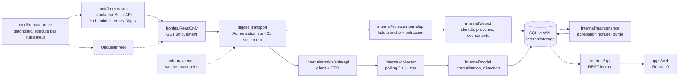

# Architecture

Supervision locale d'un Fronius Primo GEN24 3.6 Plus, en remplacement de
l'interface Angular du fabricant : un backend Go qui collecte et historise, une
API REST locale, une interface React. **Aucune écriture vers l'onduleur.**

## Flux de données

L'ordre `ReadOnly{Inner: digest.Transport{Inner: httpClient}}` est structurant :
la garde est **à l'extérieur**, donc le refus des méthodes non-GET précède tout
envoi, et l'authentification ne peut pas transformer une requête interdite en
requête acceptable.

Le simulateur et l'onduleur sont interchangeables : le client ne connaît que
`FRONIUS_SOLARAPI_URL`. La sonde est hors du flux d'exploitation — c'est un
outil de diagnostic manuel, jamais lancé par le service ni par la CI.

## Paquets Go

| Paquet | Rôle | Dépend de |
|---|---|---|
| `cmd/fronius-sim` | Simulateur déterministe de la Solar API (courbe, pannes, `/sim/health`) | — |
| `cmd/froniusd` | Service : config, collecteur, API, arrêt propre | tout |
| `cmd/fronius-probe` | Sonde lecture seule, liste blanche, sélection d'endpoint et expurgation | `config`, `fronius`, `digest`, `internalapi`, `secret` |
| `internal/config` | Configuration par variables d'environnement, garde d'écoute | `secret` |
| `internal/secret` | `secret.String` : masqué pour `fmt`, `slog` et JSON ; `Reveal()` est la seule sortie | — |
| `internal/fronius` | Garde lecture seule (`ReadOnly`) et classification HTTP/transport partagée | `froniuserr` |
| `internal/fronius/froniuserr` | Erreurs typées (`Kind`, `KindOf`) | — |
| `internal/fronius/digest` | Transport Digest (RFC 2617) : défi, en-tête, un retry sur 401, cache de nonce | `fronius`, `froniuserr`, `secret` |
| `internal/fronius/solarapi` | Client Solar API et **seul** encodage de la forme du JSON | `fronius`, `froniuserr` |
| `internal/fronius/internalapi` | Chemins internes : **liste blanche exécutable** et extraction tolérante | `fronius`, `froniuserr` |
| `internal/model` | Modèle normalisé, unités, détection à trois états, capacités, événements | `solarapi` |
| `internal/storage` | SQLite : migrations, mesures, agrégats horaires, énergie journalière, identité, anti-duplication, purge | `model` |
| `internal/maintenance` | Travaux de fond : agrégation des heures closes et purge de rétention planifiée | `storage`, `model` |
| `internal/collector` | Boucle de collecte, backoff, événements | `solarapi`, `model`, `storage` |
| `internal/detect` | Boucle de détection : identité, présence, événements, états et motifs | `internalapi`, `model`, `storage` |
| `internal/api` | API REST, validation, enveloppe et DTO | `model`, `storage`, `config`, `detect`, `internalapi` |

Le sens des dépendances est acyclique et va du plus concret (les binaires) vers
le plus abstrait (les erreurs typées). Aucun paquet interne n'importe un
`cmd/`.

## Frontend

| Chemin | Rôle |
|---|---|
| `src/lib/schema.ts` | Schémas zod **miroirs** de `internal/api/dto.go` |
| `src/lib/api.ts` | `fetchJSON` : échecs classés `network` / `http` / `schema` |
| `src/lib/queries.ts` | Hooks TanStack Query, polling 5 s, plages et pas |
| `src/lib/chart.ts` | Buckets → points de graphique, **trous matérialisés** |
| `src/lib/freshness.ts` | Décision de péremption affichée |
| `src/routes/*` | Vue d'ensemble, Système, Capacités, Paramètres |
| `src/i18n/*` | Dictionnaire plat FR, prêt pour EN/DE |

Le frontend ne parle qu'à `/api` (relayé par le proxy Vite en développement). Il
ne connaît ni l'adresse de l'onduleur, ni un identifiant : aucun identifiant
n'entre dans le processus Node, ni dans un bundle, ni dans une réponse HTTP.

## Invariants

1. **Lecture seule, garantie par construction.** Tous les clients sont
   construits derrière `fronius.ReadOnly`, qui refuse toute méthode autre que
   `GET` avant d'atteindre le transport. Vérification :
   `grep -rn 'MethodPost\|MethodPut\|MethodDelete\|MethodPatch' internal cmd`
   ne doit rien trouver hors du message d'erreur de la garde et de ses tests.
2. **Aucun zéro inventé.** Une grandeur non mesurée est `null` de bout en bout :
   colonne SQLite NULL, `nil` en Go, `null` en JSON, tiret à l'écran. Ne jamais
   calculer consommation, import/export ou autoconsommation sans Smart Meter :
   les capacités correspondantes sont indisponibles avec leur motif
   (`internal/model/capabilities.go`).
3. **Un échec de collecte n'écrit aucune mesure.** Seuls un cycle, un état
   d'erreur et un événement anti-dupliqué sont enregistrés, et aucune donnée
   n'est interpolée pour combler le trou.
4. **Le temps est explicite.** Les instants sont stockés en UTC à la
   milliseconde ; les journées de production sont locales (Europe/Brussels),
   ce qui gère les journées de 23 h et 25 h. Un horodatage d'appareil absent
   donne un échantillon `estimated`, jamais une heure présentée comme mesurée.
5. **Une seule source de vérité par contrat.** La forme du JSON Fronius
   n'existe que dans `internal/fronius/solarapi/dto.go` ; les DTO REST que dans
   `internal/api/dto.go`, reflétés par `apps/web/src/lib/schema.ts`. Toute
   dérive entre les deux est détectée par zod à l'exécution et par les tests.
6. **Pas de secret dans le dépôt, dans un journal ou dans le frontend.** Les
   identifiants de l'appareil vivent dans l'environnement de `froniusd` et de
   `fronius-probe`, sous le type `secret.String` : toute mise en forme
   (`fmt`, `slog`, JSON) produit `<redacted>`, et seul le calcul de `HA1` appelle
   `Reveal()`. La CI refuse un `FRONIUS_DEVICE_PASSWORD` non vide versionné.
7. **L'en-tête `Authorization` n'est émis qu'en réponse à un 401.** Jamais
   préemptivement, jamais vers un hôte autre que celui de `FRONIUS_SOLARAPI_URL`
   (`digest.ErrForeignHost`), jamais vers le frontend. C'est la règle du client
   officiel (`callGet$`), et elle est ce qui permet aux mêmes chemins de
   fonctionner avec ou sans authentification.
8. **« Absent » n'est pas « non déterminé ».** Chaque ressource matérielle porte
   l'un de trois états (`unknown`, `absent`, `present`), persisté tel quel,
   exposé par `/api/v1/system` et utilisé par `model.Capabilities`. Une lecture
   qui échoue produit `unknown` avec son motif — jamais `absent`.
9. **Les agrégats sont exactement dérivables des mesures conservées.** `agg_hour`
   ne contient qu'une réduction des mesures brutes et suit la même borne de
   purge : aucune valeur ne survit comme agrégat alors que ses mesures ont été
   supprimées, et aucune heure partielle n'est servie depuis un agrégat complet
   (ADR 0006). Une lecture ne sert une heure depuis les agrégats que si elle est
   entière, close et contenue dans la plage demandée ; le reste est lu dans les
   mesures brutes.

## Décisions structurantes

Elles sont détaillées dans `docs/adr/` : SQLite plutôt que PostgreSQL (0001),
polling plutôt que SSE (0002), Solar API plutôt qu'API interne (0003), séparation
supervision / commandes (0004), authentification et accès distant (0005),
rétention et agrégation (0006), packaging (0007).

## Points de fragilité connus

- **La forme de la Solar API est une hypothèse.** Le bundle du fabricant ne
  contient aucun chemin Solar API (voir `docs/SOURCES.md`) : `dto.go` encode une
  forme non validée sur le firmware 1.19.7-1. La réconciliation passe par
  `cmd/fronius-probe` et la procédure de `docs/PROBE-READONLY.md`.
- **L'API REST n'a aucune authentification** : elle est confinée à la boucle
  locale par `config.CheckListenAddress` tant que `FRONIUS_ALLOW_REMOTE=1` n'est
  pas défini (ADR 0005).
- **Les clés d'identité autres que `serialNumber` sont des candidats.** Le modèle
  et la version de firmware de `/status/version` ne sont pas nommés dans la
  partie lisible du bundle : leur extraction repose sur des listes ordonnées, à
  confirmer par capture (voir `docs/UNKNOWNS.md`).
- **La forme de `/status/activeEvents` n'est pas établie.** La lecture, la
  déduplication et la conservation du JSON brut (borné) ne dépendent pas des
  noms de champs ; seul le libellé affiché et la sévérité peuvent changer.
- **`battery.soc` reste indisponible même batterie détectée** : la présence d'un
  composant ne prouve pas qu'une mesure d'état de charge existe côté API, et
  l'annoncer disponible sans source serait l'inverse de l'invariant 2.
