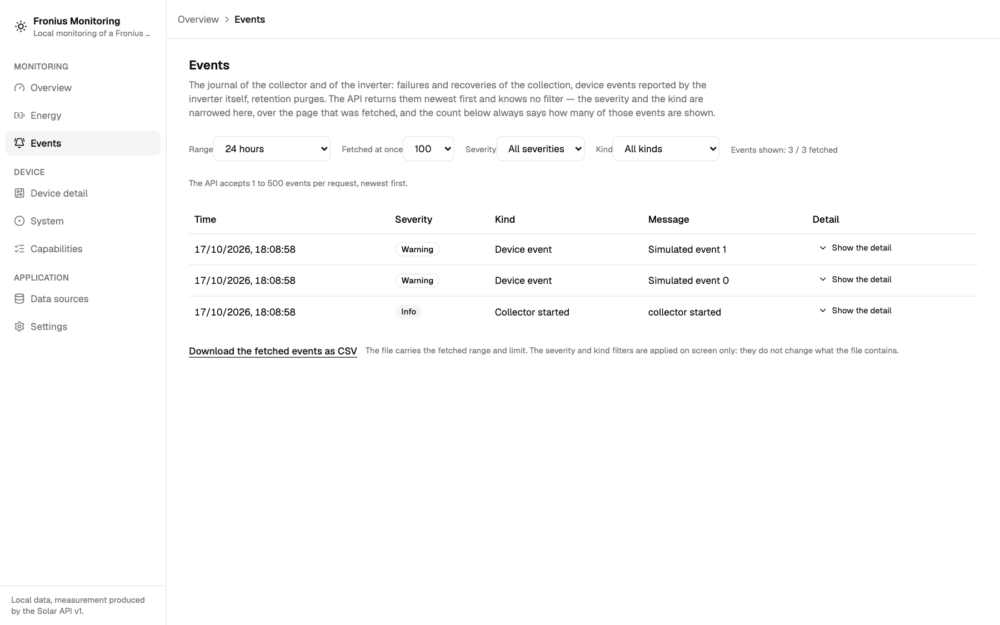
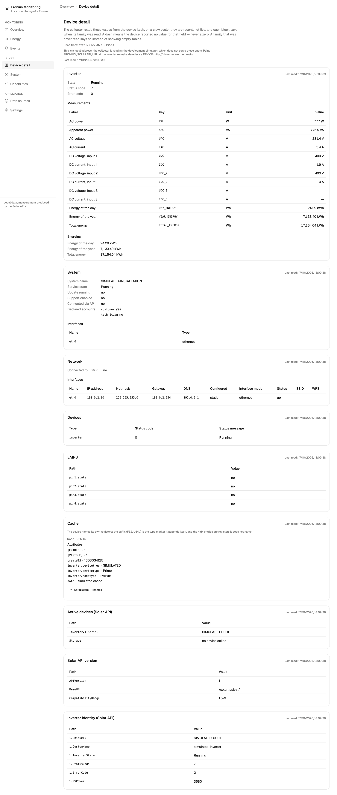
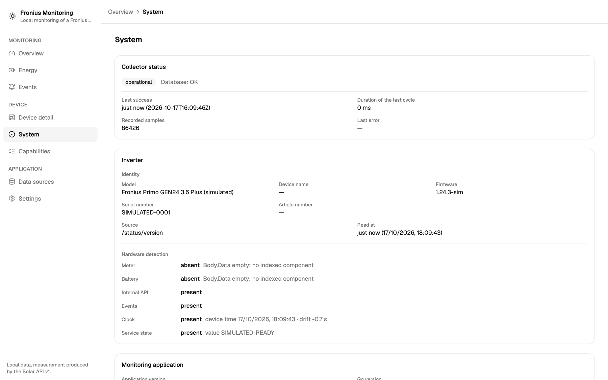
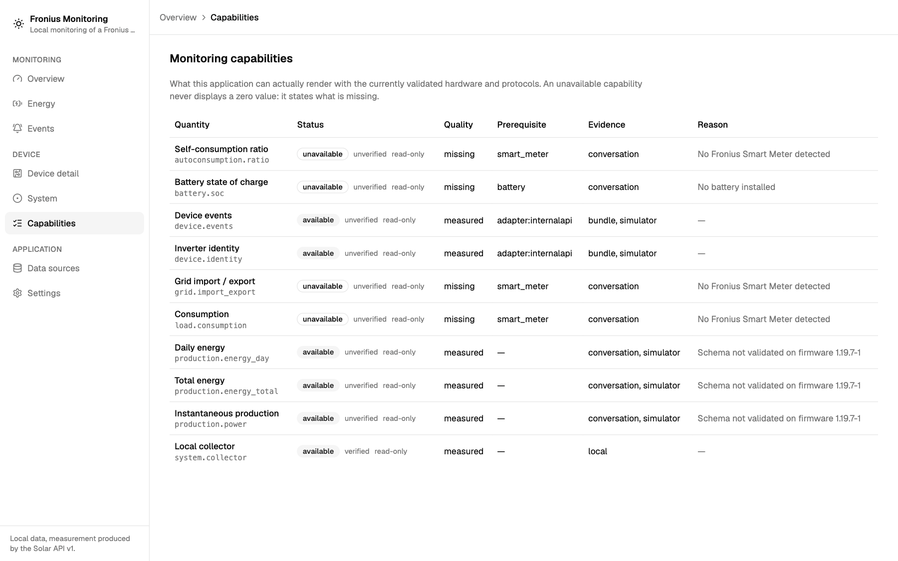
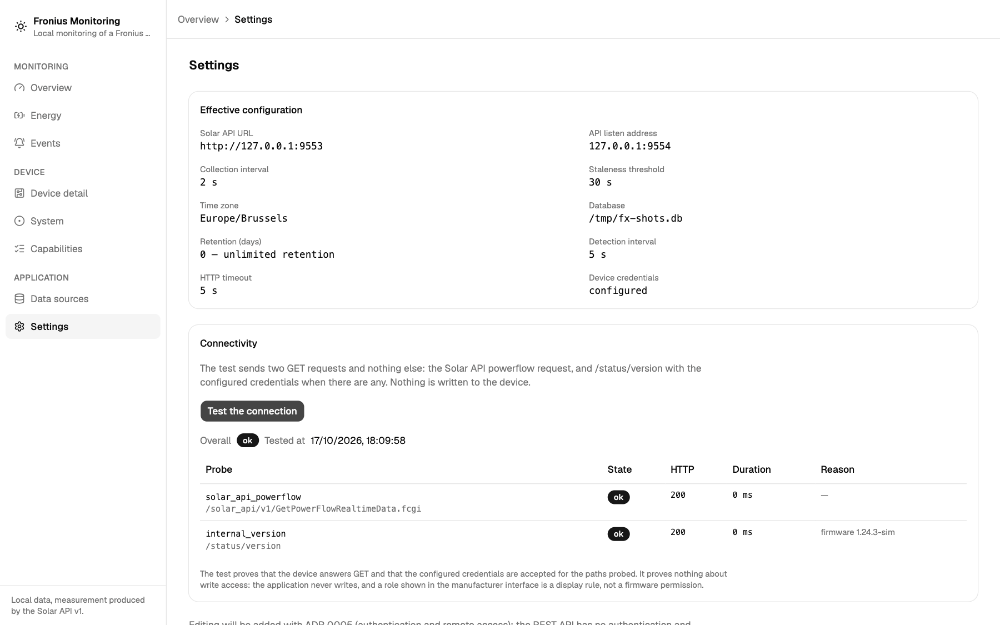
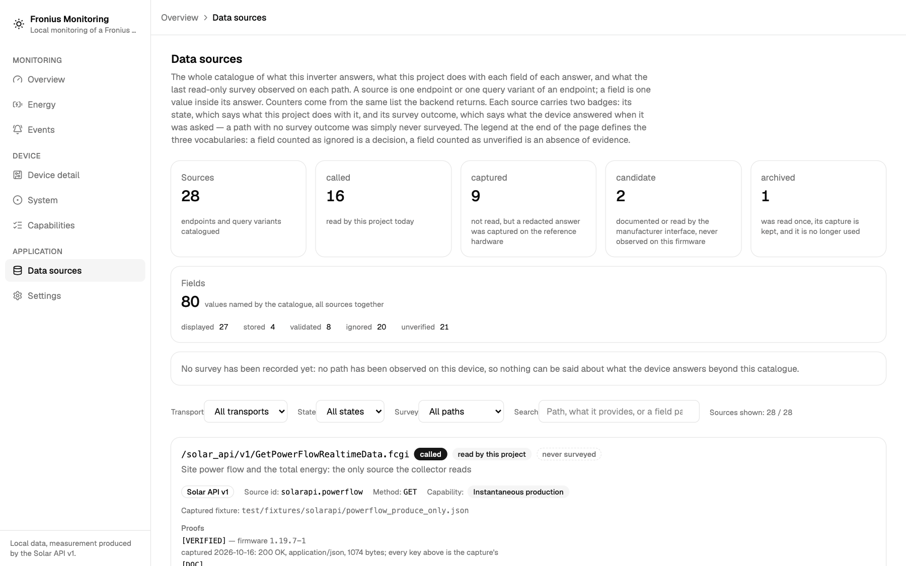
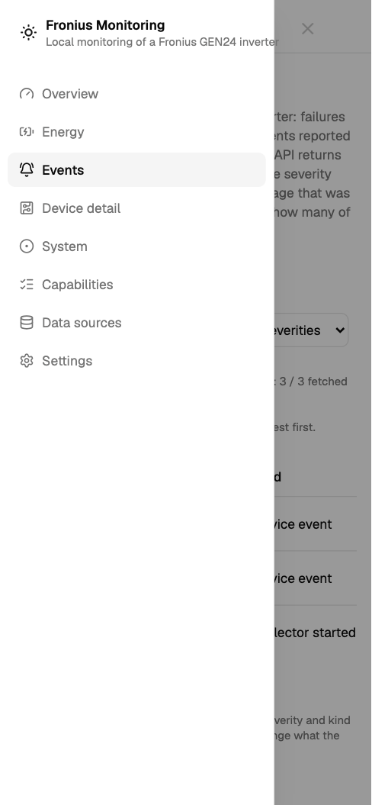
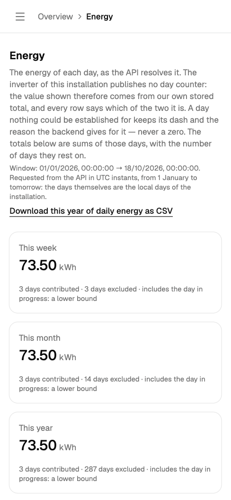

# User guide

This guide describes the application as it is installed, screen by screen, and
explains how to read what it shows. It assumes the reader owns the installation
and can read the [architecture](ARCHITECTURE.md) and [runbook](RUNBOOK.md) when
something needs operating rather than understanding.

The screenshots below were taken against the simulator, with synthetic data.
Nothing in them is a reading from a real inverter.

## 1. What it is, and what it never does

The application is a local, read-only supervisor for a Fronius GEN24 inverter.
A Go service (`froniusd`) collects measurements, stores them in SQLite, and
serves a small REST API; the React interface is served beside that API and talks
only to same-origin `/api`. There is no cloud service and no account.

It never sends a method other than `GET` to the inverter, and it never changes
the inverter's configuration. The refusal is structural: every client is wrapped
in a read-only guard that rejects the other verbs before a request leaves the
process. Authentication is used only to answer a `401`; the `Authorization`
header is never sent preemptively.

What it is not, today: there are no commands, no configuration writes, no theme
switching, no multi-device support and no cloud connection. The Settings screen
is a read-out, not a form.

## 2. Getting it running

The repository [README](../README.md) lists the prerequisites and the full set
of commands. From the repository root, the development stack is three commands
in three terminals:

```bash
make dev-sim     # simulator on 127.0.0.1:8081
make dev-api     # service on 127.0.0.1:8080, collector included
make dev-web     # interface on 127.0.0.1:5173
```

Then open <http://127.0.0.1:5173>. To point the service at the real inverter,
use `make dev-device DEVICE=http://<inverter>`; credentials, when the device asks
for them, are set in the service's environment as described in the
[runbook](RUNBOOK.md). The interface never receives the inverter address or a
credential.

## 3. A screen-by-screen tour

The shell is the same on every screen: a sidebar grouped into **Monitoring**
(Overview, Energy, Events), **Device** (Device detail, System, Capabilities) and
**Application** (Data sources, Settings), a breadcrumb in the sticky header, and
a skip link before the navigation. On a narrow viewport the sidebar becomes a
drawer.

### Overview


This is the live page. The four cards carry the instantaneous production, the
energy of the day, the energy of the year and the collector's own state (with
the number of recorded samples and the duration of the last cycle). Beside the
title, the inverter state chip comes from the device detail, and the freshness
badge says whether the last measurement is fresh or stale.

Under the cards, **Produced power** plots the selected range. The range selector
offers 24 hours, 7 days and 30 days, plus a custom range with its own start, end
and step; the download link beside it exports exactly that range. When a
quantity cannot be measured — consumption, import/export or self-consumption
without a Smart Meter, for example — it is not drawn as a zero: a panel below the
chart lists the unavailable capabilities and their reasons. The Overview does
not show separate grid, load or battery cards; their availability is decided by
the Capabilities page.

### Energy


The page asks the API for the current year, up to tomorrow's local midnight, so
that the three rollups mean something. The rollups — this week, this month, this
year — each state how many days contributed, how many were excluded, and that
the total is a **lower bound** because the day in progress is included.

Below them, **Days shown** reduces the table and the chart to the last 7, 30 or
90 days, or the whole fetched window; the counter beside it reads, for example,
`30 / 289 day(s) of the window fetched`. The bar chart draws one bar per day and
keeps a day without a value as a gap. The table has one row per local day with
the value, a **device counter** or **derived from total** marker, and the note
column: the backend's reason beside a dash, or the **day in progress** badge.

### Events



The journal holds the collector's failures, recoveries and start, retention
purges, and the events the inverter itself reports. One row per event: time,
severity, kind, message, and a **Show the detail** disclosure for the raw
payload.

The **Range** preset (24 hours, 7 days, 30 days, all recorded events) and the
**Fetched at once** limit (50, 100, 250 or 500) are sent to the API. **Severity**
and **Kind** are not: the endpoint has no such parameters, so those two filters
act on the page already fetched. That is why the header always states
`Events shown: n / m fetched` — narrowing the screen never fetches more, and
raising the limit is how a filter is given more to work on.

### Device detail



This page shows what the device says about itself, not its production. There are
nine families in three groups: the **inverter** block (state, status code, error
code, thirteen measurements and the day, year and total energies); the
**system**, **network**, **devices**, **emrs** and **cache** blocks; and the
Solar API families **Inverter identity (Solar API)**, **Active devices (Solar
API)** and **Solar API version**.

The readings are snapshots on a slow cycle, not live values. Every block carries
its own **Last read** instant, and a family that was never read says so instead
of showing an empty table. A family that failed is marked **Unavailable** with
the backend's reason. The cache block collapses its register table; the device
names most registers itself with a type suffix such as `_F32`, and leaves the
rest as bare `<id>` entries.

### System



The top card is the collector's status: database health, last success, last
cycle duration, recorded samples and last error. The inverter card carries the
identity (model, name, firmware, serial and article numbers, source and read
instant, each shown as a dash when absent) and the **Hardware detection** rows:
meter, battery, internal API, events, clock and service state. Each detection is
**present**, **absent** or **unknown**, and a state that is not present carries
its reason.

The clock and service rows are explained in section 5. The last card lists the
application version, the Go version and the service uptime.

### Capabilities



This is the source of truth for what the installation can actually monitor.
Each quantity — production, energies, grid exchange, consumption,
self-consumption, battery state and the rest — has a status (**available** or
**unavailable**), a verification word (**verified** or **unverified**), a
quality (**measured**, **estimated** or **missing**), its prerequisite, its
evidence and a reason. An unavailable capability never displays a numeric zero;
it states what is missing.

### Settings



The page is read-only. It shows the effective configuration: Solar API URL, API
listen address, collection and detection intervals, staleness threshold, time
zone, database path, retention depth and HTTP timeout. **Device credentials**
appear only as **configured** or **not configured**; no username or password is
ever displayed or returned by the API.

The **Connectivity** card runs the test described in section 6 and shows the
overall verdict, the test instant, and one row per probe with its state, HTTP
status, duration and reason.

### Data sources



This is the machine-readable catalogue of every source the project knows, and
what it did with each field. The counters at the top come from the backend's own
list. Each source card shows its transport (Solar API v1 or Internal API), its
state (`called`, `captured`, `candidate` or `archived`), its method, the
capability it feeds, its proofs and references, and — when a survey was
recorded — the device's answer to the read-only survey.

Every field of every source has a status: **displayed**, **stored**,
**validated**, **ignored** or **unverified**, with the reason and the capability
it belongs to. The **Field inventory** disclosure opens that table. A source
with no survey shows **never surveyed**, which is not the same as a path the
device answered with `404`. Filters narrow by transport, state, survey outcome
and free-text search, and the page states how many sources are shown.

### On a phone



Below the desktop breakpoint, the sidebar is replaced by a menu button in the
header. The drawer holds the same three groups and the same order as the
sidebar; the breadcrumb stays in the header.



Pages stack into one column. Tables scroll horizontally rather than dropping
columns, so the day, value, source and note stay together; the same is true of
the Events journal and the Capabilities table.

## 4. Reading the numbers

**Measured and derived.** A value is either the device's own counter or a value
derived from the stored total energy. On this firmware the device publishes no
day counter, so most daily values are **derived from total**, and the Energy
table says so on every row. The Overview marks the same thing as **estimated
from the total**. A derived value is not a measurement: the total is refreshed
by the device about every five minutes, and a derivation is refused when no
baseline exists within ten minutes of the local boundary or when the counter
went backwards.

**Gaps are gaps.** A period with no collection is not filled in. The power chart
breaks its line, the daily chart leaves an empty slot, and neither is drawn as
zero. The Energy table lists every local day of the window once anything was
recorded in it; a day nothing could be established for keeps its dash and the
reason.

**A rollup is a lower bound.** The weekly, monthly and yearly totals sum only
the days that could be measured. Each states how many days contributed and how
many were excluded, and includes the day in progress, whose value grows until
midnight. Read them as floors, not as final totals.

**Stale is not wrong.** The freshness badge compares the last measurement with
`FRONIUS_STALE_AFTER`. A stale value is still the last known value; it is old,
not incorrect. Empty means no measurement was recorded at all, and a dash means
one particular value is absent, with its reason beside it.

**Why a dash.** A dash is a fact, not a rendering failure: the device reported no
value for that field, or the derivation was refused. The reason is printed next
to it — a missing baseline, a baseline too far from the boundary, a counter that
went backwards, a field the device leaves empty. Nothing is ever shown as `0` to
stand in for an absent reading.

**Unverified is not false.** Several internal paths remain **unverified** on
hardware: the project has never probed them on a real inverter, and the field
status in Data sources says so. This is an absence of evidence, not a claim that
the path fails. Where a value is absent, the screen shows a dash and its reason
rather than a zero.

**Local days.** Production days are the installation's local days
(`FRONIUS_TZ`, Europe/Brussels by default), not UTC days. A 23-hour or 25-hour
day at a daylight-saving change is handled as such. Instants in the database are
stored in UTC; only the day boundaries are local.

## 5. The device's own clock and the self-test state

Two rows of the System screen are readings taken from the device's internal
paths, and both are read-only.

**Clock.** The row shows the device time and its **drift** against the host
clock. A drift beyond **±60 s** raises a **Clock drift warning** badge. The
warning matters because the daily energy's boundaries are computed from the
installation's clock while the inverter's own day counter resets at the
inverter's midnight: a drift shifts what "today" means, and the derived daily
values only tolerate a baseline within ten minutes of the boundary. If the clock
cannot be read, the row shows no time and no drift, only the state and the
reason — never `0 s` and never a 1970 timestamp.

**Service state.** The row shows the grid-limits self-test state the device
reports (`/commands/GetServiceState?serviceId=21`), or `BLOCKED` when the
device's answer is not a success, exactly as the manufacturer's client renders
it. The application never triggers a self-test; it only reads the state the
device already publishes.

Both internal paths are **unverified on hardware**: the project has never probed
them on a real inverter. They are served by the simulator, and the guide's
screenshot shows the simulator's values.

## 6. The connectivity test, and what it does not prove

**Test the connection** on the Settings page sends two `GET` requests and
nothing else:

1. the Solar API powerflow request, which proves the device answers through the
   application's own client path;
2. `/status/version` with the configured credentials, which proves the Digest
   route accepts them. This second probe is **skipped**, never attempted, when
   no credentials are configured.

Each probe reports one of seven states:

| State | Meaning |
|---|---|
| `ok` | answered with the expected content |
| `skipped` | deliberately not attempted, because no credentials are configured |
| `unauthorized` | the device refused the credentials |
| `absent` | the path is not served by this firmware |
| `timeout` | no answer within the HTTP timeout |
| `unreachable` | transport failure: wrong address, network, device down |
| `error` | any other classified failure |

The overall verdict is `ok` when every probe is `ok` or `skipped`, `failed`
when the powerflow probe itself fails, and `partial` otherwise. The result is
cached for **10 s**; pressing the button again within that window shows the
same answer with a **cached** marker, so a wrong password is not retried against
the device's authentication counter.

The test proves reachability and that the configured credentials are accepted
**for the two paths probed**. It proves nothing about write access. The
application never writes, and a role shown in the manufacturer's interface is a
display rule, not a firmware permission.

## 7. Exporting history

Each history screen has a download link that adds `?format=csv` to the route it
already queried. The file is the screen's data, not a bulk dump:

| Screen | Route | Range carried by the file |
|---|---|---|
| Overview chart | `/api/v1/timeseries` | the selected range and step |
| Energy | `/api/v1/energy/daily` | the year window the page fetched |
| Events | `/api/v1/events` | the selected range and limit |

Columns are the JSON field names, in order, and a missing value is an **empty
cell** — never `0`, never `null`. On the Events page, the severity and kind
filters are applied only on screen: the CSV carries the fetched range and limit
and does **not** include those filters, as the note next to the link says. An
invalid range is refused before the first byte with the ordinary JSON error, so
a half-written file is not produced.

## 8. Your data

Everything lives in one SQLite database, in WAL mode, at `FRONIUS_DB_PATH`
(`./data/fronius.db` by default): measurements, hourly aggregates, events,
identity, detection state and the device detail snapshots.

Backup, verification and restore go through `cmd/fronius-backup`, wrapped by
`make backup` and `make restore`:

```bash
make backup                                  # consistent snapshot, may run live
go run ./cmd/fronius-backup verify -file <backup>
make restore FRONIUS_BACKUP=<backup>         # stop froniusd first
```

A restore is transactional and schema-checked: it refuses a backup whose
migration set differs, replaces every table in one transaction, and keeps the
current database aside as `<db>.pre-restore-<UTC instant>.db`. `restore` requires
`-yes` when called directly.

Retention is set by `FRONIUS_RETENTION_DAYS`. The default `0` keeps everything
and schedules no purge. With `N > 0`, the service purges at startup and then once
per local day from 03:00, deleting measurements, events, collection cycles,
anti-duplication marks and hourly aggregates older than local midnight `N` days
back. Each purge is recorded as a `retention_purge` event, so the journal shows
when data was removed. Take a backup before enabling retention.

## 9. Keyboard and mobile

The skip link is the first focusable element and jumps to the main landmark.
Focus rings are visible on links, buttons, selects and the drawer controls. The
sidebar is a labelled navigation landmark on desktop; the breadcrumb is a
labelled landmark of its own.

The mobile drawer is opened by a menu button that reports its expanded state. It
locks page scrolling, moves focus into the drawer, and closes on **Escape**, on a
click on the overlay, or on any link inside it; focus then returns to the menu
button. Every disclosure — event detail, field inventory, cache registers — is a
real button with an expanded state, and its panel stays in the document.

The interface ships with its default light theme; it has no theme switch. The
mobile layout is the same application at a narrower viewport, not a reduced
feature set.

## 10. When something looks wrong

| What you see | First check | Runbook section |
|---|---|---|
| **API unreachable** banner | is `froniusd` running, and does the page's `/api` reach it? | Diagnosis by symptom |
| **Stale data** badge while the device answers | `collector.last_success_utc`, the poll interval and the staleness threshold | Diagnosis by symptom |
| Energy shows dashes, or no day at all | the reason in the Note column; whether any sample carries a total energy; the ten-minute baseline tolerance | Day, year and daily energies (derived) |
| Every Device detail family unavailable, all `404` | the source the daemon polls — a daemon still pointed at an old simulator answers `404` to the internal paths | Device detail |
| **Clock drift warning** | the device clock and the host clock; a drift near ten minutes distorts the daily boundaries | The device's own readings (System screen) |
| Clock or Service state **unknown** | the reason beside the state; usually credentials absent or refused | Device credentials |
| Connectivity `partial` or `unauthorized` | the credentials, the account and the realm; `unauthorized` means the version probe was refused | The connectivity test |
| Events shows nothing after narrowing | the client-side severity and kind filters; the `visible / fetched` count; raise the limit | The Events and Energy pages |
| A source says **never surveyed** | the read-only survey was never run on this firmware; this is not a `404` | Surveying every catalogued path |
| Database error, or a restore refused | `db.ok`; the backup's migration set; whether `froniusd` was stopped | Backup and restore; Retention and purge |

The [operations runbook](RUNBOOK.md) is the reference for every row: it gives
the commands, the exact fields to read and the decision to take.

## Provenance of these screenshots

The ten images in `docs/screenshots/` were captured on 2026-10-17 against
`cmd/fronius-sim`, which reports firmware `1.24.3-sim`, with a two-day backfill
of simulator history. Desktop screens were captured at 1440×900 and mobile
screens at 390×844, in the application's default light theme. The data is
synthetic: the values, events and device identities are produced by the
simulator, not read from an inverter on this date.
